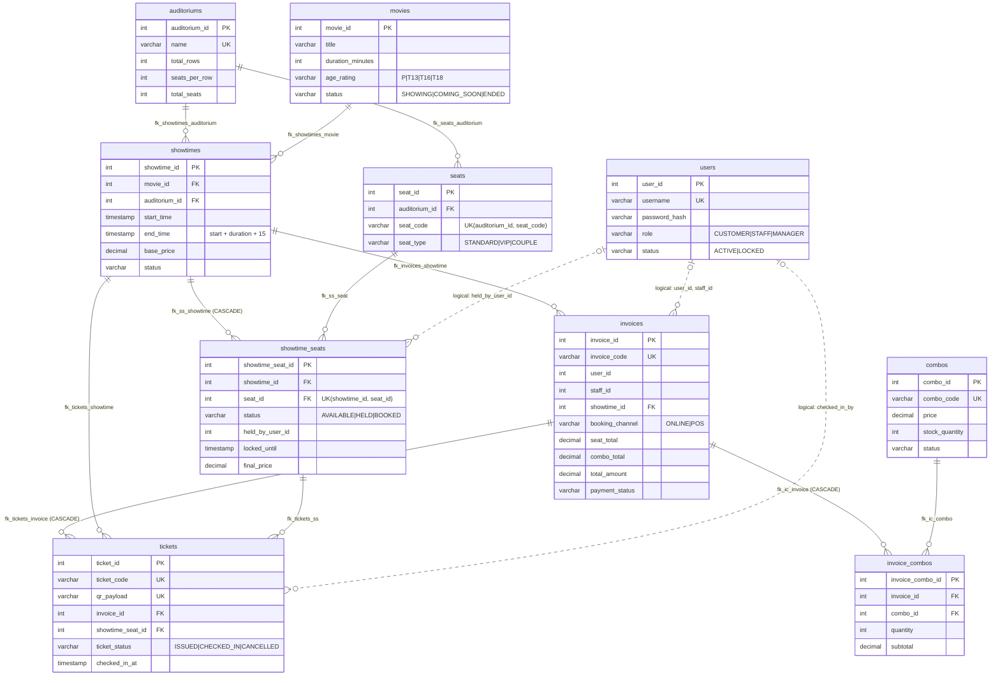
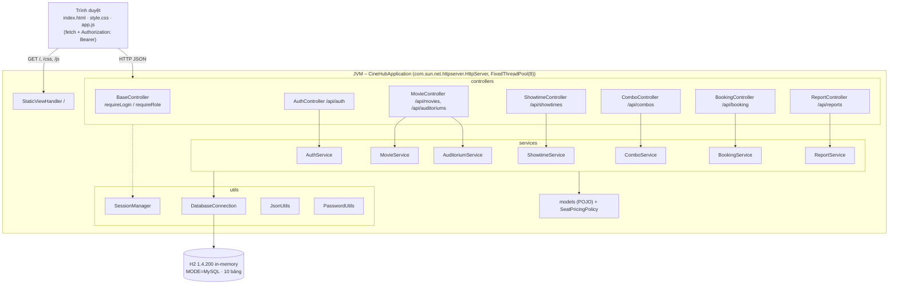
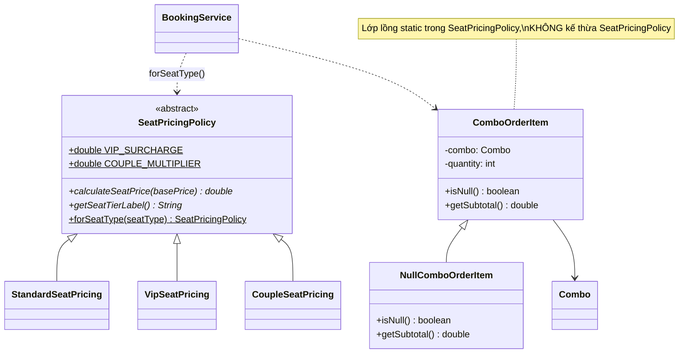
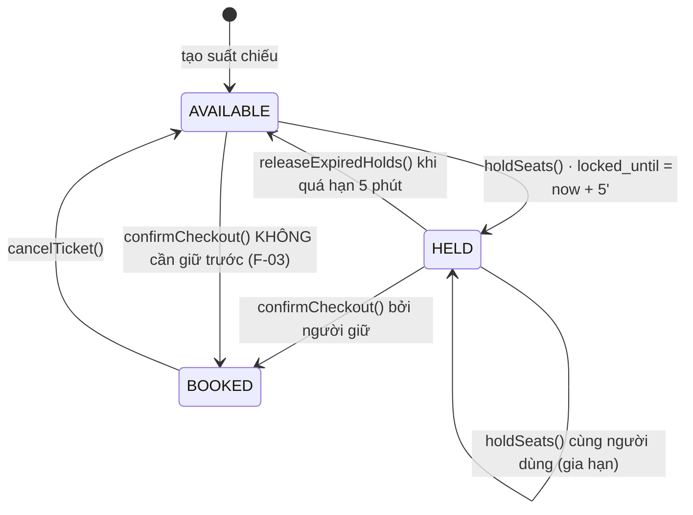
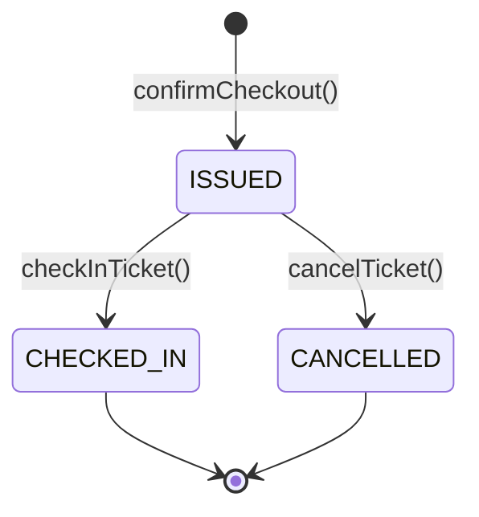
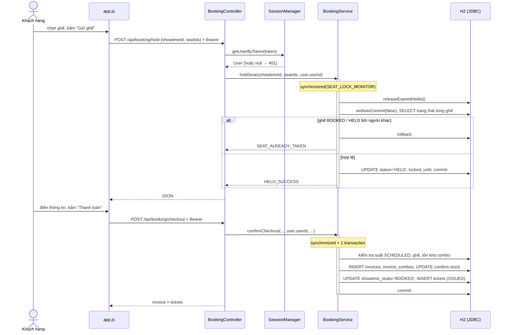
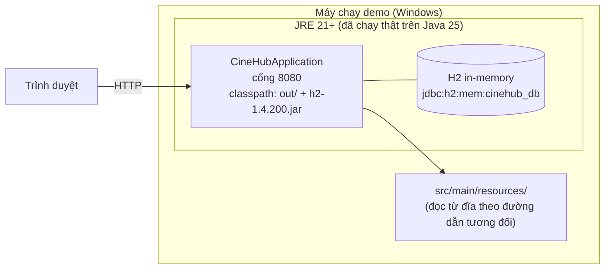

# DIAGRAM REVIEW – Sơ đồ, biểu đồ, bảng

## 1. Tình trạng

**Không kiểm tra hay sửa được sơ đồ nào trong 6 tài liệu**, vì không tìm thấy file DOCX nào (xem `AUDIT_REPORT.md` §1). Repo cũng không có file hình ảnh, `.puml`, `.drawio` hay `.mmd` nào.

Thay vào đó, file này cung cấp hai phần:

- **§2**: danh sách các sơ đồ mà mỗi tài liệu cần có, kèm các điểm phải khớp với code. Nhóm dùng như checklist khi tự kiểm tra sơ đồ hiện có.
- **§3**: **sơ đồ tham chiếu dựng từ mã nguồn v1.1.0**, viết bằng Mermaid (xem được trên GitHub và VS Code; xuất PNG/SVG bằng mermaid.live hoặc `mmdc`). Đây là "đáp án" để so với sơ đồ của nhóm, **không phải bản sửa của sơ đồ gốc**. Mọi tên lớp, bảng, trạng thái đều lấy nguyên văn từ code.

## 2. Checklist theo tài liệu

| Tài liệu | Sơ đồ/bảng cần có | Điểm bắt buộc phải khớp với code |
|---|---|---|
| ScopeDocument | Sơ đồ ngữ cảnh, bảng CSD01–CSD05 | 3 actor: Khách hàng (CUSTOMER), Nhân viên (STAFF), Quản lý rạp (MANAGER); thêm "Khách vãng lai" nếu mô tả xem phim không cần đăng nhập. Không có tác nhân "Cổng thanh toán": hệ thống **không tích hợp** VietQR/MoMo/Visa thật, `payment_method` chỉ là nhãn |
| ProjectPlan | Gantt, WBS, sơ đồ tổ chức, timeline Sprint, bảng phân bổ nguồn lực | Tên, MSSV, vai trò phải khớp `README.md` (5 thành viên). Ngày Sprint trong CHANGELOG (30/03, 20/04, 10/05, 25/05/2026) **không có bằng chứng trong git** (chỉ có commit 07/11 và 13/11/2026) – xem MISSING_EVIDENCE M-02 |
| SRS | Use Case Diagram, Activity Diagram cho đặt vé/POS/soát vé | Use case lấy từ `DOCUMENT_TRACEABILITY.md` §2. «include»: *Đặt vé online* include *Giữ ghế*? **Sai với code**, vì checkout không bắt buộc giữ ghế (F-03); nếu SRS yêu cầu bắt buộc thì phải ghi là yêu cầu chưa đạt. *Soát vé* không extend *Hủy vé*. Không có use case "Quản lý phòng chiếu" (chỉ có xem) |
| SDD | Kiến trúc, Package/Component, Class, Sequence, State, ERD, Deployment | Không có Spring/Servlet/Tomcat/JPA/ORM: dùng `com.sun.net.httpserver.HttpServer` + JDBC thuần. CSDL **H2 in-memory** (không phải MySQL đang chạy). **10 bảng**. Null Object là `NullComboOrderItem`. RBAC qua `BaseController` |
| TestPlan | CFG cho `authenticate`, `createShowtime`, `holdSeats`; bảng quyết định giá ghế/soát vé | V(G): `authenticate` = 5 (4 quyết định + 1), `createShowtime` = 6 theo Javadoc; `holdSeats` ghi 6 nhưng mới có 5 ca test |
| TestReport | Bảng kết quả, biểu đồ Pass/Fail | Chỉ được dùng số liệu đã chạy thật: 23/23 (v1.0.0), 32/32 (v1.1.0). **Không có số liệu coverage** |

## 3. Sơ đồ tham chiếu dựng từ code

### 3.1 ERD (10 bảng – `config/schema.sql`)

Quan hệ nét liền là FK có thật trong schema. Bốn quan hệ tới `users` **không có FK** (chỉ là liên kết logic, xem F-15); chúng được ghi bằng nhãn "logical" vì Mermaid không vẽ được nét đứt cho từng quan hệ.

### 3.2 Kiến trúc phân tầng / package

### 3.3 Lớp tính giá (Polymorphism + Null Object)

### 3.4 Máy trạng thái `showtime_seats.status` (đúng như code đang chạy)

### 3.5 Máy trạng thái vé (`tickets.ticket_status`)

Các trạng thái **có trong schema nhưng không có chuyển trạng thái nào trong code**, nên không được vẽ như thể đã hoạt động: `showtimes.status` = `CANCELLED`/`COMPLETED`; `invoices.payment_status` = `PENDING`/`REFUNDED`.

### 3.6 Sequence: giữ ghế rồi thanh toán online

### 3.7 Deployment

## 4. Biểu đồ thống kê

Không có biểu đồ thống kê nào để kiểm tra, cả trong tài liệu lẫn trong giao diện (Dashboard v1.1.0 chỉ có ô KPI và bảng). Các biểu đồ đề xuất cùng điều kiện tiên quyết ở `AUDIT_REPORT.md` §4.3. Không biểu đồ nào được tạo bằng số liệu giả.
